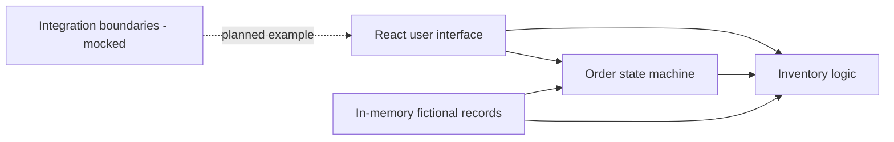

# Operations Platform — Portfolio Demo

A modern, interactive operations dashboard showcasing stateful business workflows, inventory-aware order fulfillment, and the design of enterprise integration boundaries. **All records are fictional; this demo connects to no live enterprise systems.**

Inspired by my professional experience with ERP and CRM integrations, Python automation, B2B operations, and data engineering. The code in this repository is an independent implementation, not employer-owned production code.

## Features

- **Overview dashboard:** KPIs, order pipeline, operational activity, and exceptions.
- **Order management:** Advance fictional orders through Quoted → Approved → Fulfillment → Completed.
- **Inventory-aware fulfillment:** Approved orders require adequate stock before entering fulfillment; available quantities decrease on transition.
- **Stock replenishment:** Restock a fictional SKU and retry a previously blocked order.
- **Integration architecture:** Illustrative ERP, CRM, commerce, and worker boundaries (not live connectors).
- **Resettable sandbox:** Explore freely; reset returns to the original sample state.
- **Automated tests:** Pure business logic is covered by Node's built-in test runner.

## Run locally

Requires Node.js 20 or newer.

```bash
npm install
npm run dev
```

To run automated tests or create a production build:

```bash
npm test
npm run build
```

## Architecture



This is deliberately a client-side demo; state resets when the page reloads. The integration cards are mockups and do not communicate with production APIs.

## Try the inventory safeguard

1. Go to **Orders** and try advancing `SO-1003` to fulfillment. The request is blocked because stock is insufficient.
2. Go to **Inventory**, add 5 units of `Wire Shelving Kit`, and return to **Orders**.
3. Advance `SO-1003` again. The order proceeds and stock is reserved.
4. Use **Reset demo** to restore starting data.

## Technology

React 19 · JavaScript · Vite 6 · CSS · Node.js test runner

## Professional context

My engineering experience includes enterprise data processing, ERP/CRM integrations, vendor automation, and backend workflows. This standalone demo illustrates selected software engineering patterns; it does not claim to expose or reproduce a full private production application.

[Visit my portfolio](https://cainmacias-portfolio.netlify.app/)
