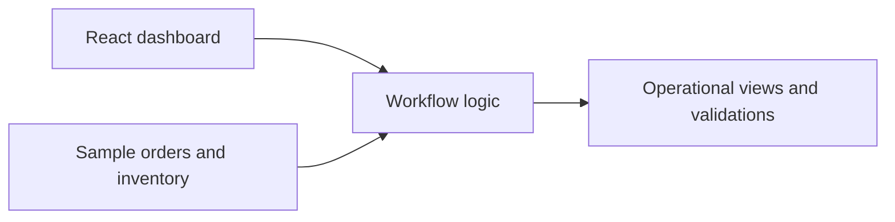

# Operations Platform — Portfolio Demo

A self-contained, interactive web application demonstrating how connected workflows can help teams manage orders, validate inventory, and understand operational activity.

This project is inspired by my experience working with enterprise systems, process automation, ERP integrations, and business operations. It is an independently implemented demonstration, with fictional data and no connection to company production systems.

## Highlights

- **Operations dashboard:** An overview of sample order and inventory activity.
- **Order lifecycle:** A defined workflow from `quoted` to `approved`, `fulfillment`, and `completed`.
- **Inventory validation:** Sample stock checks and readable exception messages.
- **Testable business logic:** Workflow rules separated from the UI, with automated tests.
- **Responsive frontend:** Built with React and Vite.

## Technology

React · JavaScript · Vite · Node.js · Automated tests

## Get started

Requires Node.js 20 or later.

```bash
npm install
npm run dev
```

Open the local URL displayed by Vite.

To run the tests or create a production build:

```bash
npm test
npm run build
```

## How it works



The demo intentionally focuses on small, understandable workflows so visitors can review both the interface and the underlying implementation. It does not require credentials, accounts, or external services.

## Project context

My professional work includes integrating business systems, automating data processing, and improving operational workflows. This repository illustrates selected software design concepts from that broader experience; it is not the source code of any employer-owned application. All business data in this demo is fictional.

## Portfolio

Visit my [engineering portfolio](https://cainmacias-portfolio.netlify.app/) for additional projects and professional background.
