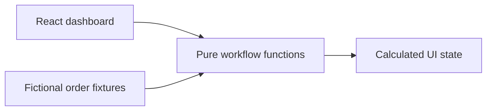

# Operations Platform — Portfolio Demonstration

> **Working title:** Replace this title and repository name with the exact name on the portfolio before publishing.

A standalone, independently written interactive demonstration of interconnected business operations concepts: order states, inventory validation, and operations visibility.

**This is NOT the original `jeans.ops` application.** It is not a fork, copy, or release of an employer system. All sample customers, products, and orders are fictional. No live ERP, CRM, Shopify, or employer endpoints are contacted.

## Features
- Browser dashboard with fictional operational metrics
- Explicit order state machine: `quoted` → `approved` → `fulfillment` → `completed`
- Simulated stock validation with human-readable exception messages
- Responsive React UI, with zero backend credentials
- Tests for workflow transitions and summary counts

## Run locally
Requires Node.js 20+.

```bash
npm install
npm run dev
```

Visit the local address printed by Vite.

## Test / build
```bash
npm test
npm run build
```

## Architecture


## Scope and honest attribution
This is a **portfolio recreation of concepts**, not production source code. It demonstrates simplified operational concepts and is not a claim that the full production application, ERP integration, permissions model, or backend service is open source. Specific implementation claims about private work should be reviewed before adding to this document.

## Publication checklist
- [ ] Confirm with the user the **exact portfolio project title** and update repository metadata and README accordingly.
- [ ] Obtain any necessary employer approval for high-level descriptions of workplace work.
- [ ] Confirm every file has been reviewed for secrets, identities, client data and proprietary details.
- [ ] Add original screenshots **of this demo** (not confidential dashboards).
- [ ] Publish from a **fresh Git history**, not a copy of the private repo history.
- [ ] Link from the portfolio project card to this repository and back.

## License
No open-source license has been selected yet. Add one only when the project owner chooses the terms.
